# Détection de fraude explicable — jeu n° 1 (Sparkov)

Projet *Challenge 2* — Data Mining, ENSI II3-IA , 2026-2027.
Application web interactive qui **détecte** les fraudes à la carte bancaire, **compare** approches supervisées et non supervisées, **fixe un seuil d'alerte selon un coût métier** et **explique chaque alerte** (SHAP + codes motifs), avec une **API FastAPI**.

**Jeu de données** : *Credit Card Transactions Fraud Detection* (simulateur Sparkov, synthétique) — 1 852 394 transactions, 9 651 fraudes (0,521 %), janvier 2019 → décembre 2020.

---

## 1. Installation et exécution

```bash
pip install -r requirements.txt

# Données : kaggle.json dans ~/.kaggle, puis
python -m src.data                 # ou déposer fraudTrain.csv / fraudTest.csv dans data/

python train.py --k-rate 0.005 --c-alert 5   # entraîne, évalue, écrit artifacts/
streamlit run app.py               # application (5 onglets)
uvicorn api:app --reload           # API  -> http://127.0.0.1:8000/docs
```

| Option | Rôle | Valeur utilisée |
|---|---|---|
| `--k-rate` | budget d'alertes (fraction des transactions) | 0,005 (≈ 1 853 alertes sur le test) |
| `--c-alert` | coût d'analyse d'une alerte | 5 (même unité que le montant) |
| `--seed` | graine aléatoire | 42 |

## 2. Structure

| Fichier | Rôle |
|---|---|
| `src/data.py` | chargement, téléchargement Kaggle, import de fichier |
| `src/features.py` | variables temporelles, géographiques, comportementales (passé strict) |
| `src/split.py` | séparation chronologique 60/20/20 |
| `src/evaluate.py` | PR-AUC, ROC-AUC, précision@k, rappel@k, F2, MCC, courbe de coût |
| `src/explain.py` | codes motifs (variables redondantes fusionnées) |
| `train.py` | pipeline complet → `artifacts/` |
| `app.py` | application Streamlit |
| `api.py` | API FastAPI (`/health`, `/model-info`, `/predict`) |
| `src/make_synthetic.py` | jeu factice pour tester sans Kaggle |

## 3. Méthodologie

- **Séparation chronologique** : `fraudTrain` et `fraudTest` de Kaggle sont fusionnés, triés par date, puis redécoupés **60 / 20 / 20**. Le futur n'est jamais vu à l'entraînement.
- **Variables** (≈ 29) : heure en codage cyclique (sin/cos), jour de semaine, week-end, nuit, distance client–marchand (haversine), âge, taille de ville, genre, catégorie (one-hot) et **variables comportementales par carte** : nombre de transactions sur 1 h et 24 h, temps depuis la transaction précédente, montant ÷ moyenne des 30 derniers jours.
- **Pas de fuite de données** : toutes les fenêtres comportementales utilisent uniquement le **passé strict** de la carte (la transaction courante est exclue). Première transaction d'une carte : valeurs neutres (ratio = 1, délai plafonné à 720 h).
- **Déséquilibre** : trois stratégies comparées en validation, appliquées **au train seul** (aucune, pondération `scale_pos_weight`, sous-échantillonnage 1:10).
- **Modèles** : XGBoost et régression logistique pondérée (supervisés) ; Isolation Forest et LOF (non supervisés, LOF entraîné sur un sous-échantillon de 20 000 lignes pour le temps de calcul).
- **Coût métier** = montant des fraudes manquées + `c_alert` × nombre d'alertes. Le seuil est **choisi sur la validation**, puis **confirmé sur le test**.
- **Budget k** : 0,5 % des transactions (≈ 1 853 alertes sur le test), soit environ 1,4 × le nombre de fraudes du test (≈ 1 349) ; à ajuster selon la capacité réelle des analystes.

## 4. Exploration des données (Module 1)

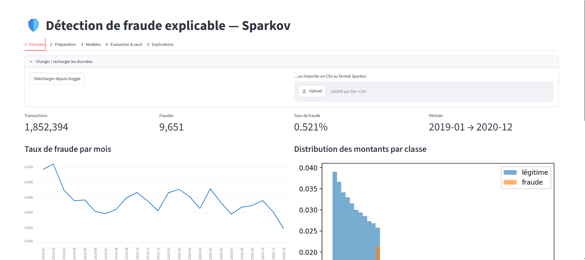

Le taux de fraude **baisse au cours du temps** (≈ 1 % début 2019, ≈ 0,2–0,5 % fin 2020) : c'est un vrai décalage de distribution, visible aussi dans le découpage (0,58 % en train → 0,51 % en validation → 0,36 % en test).

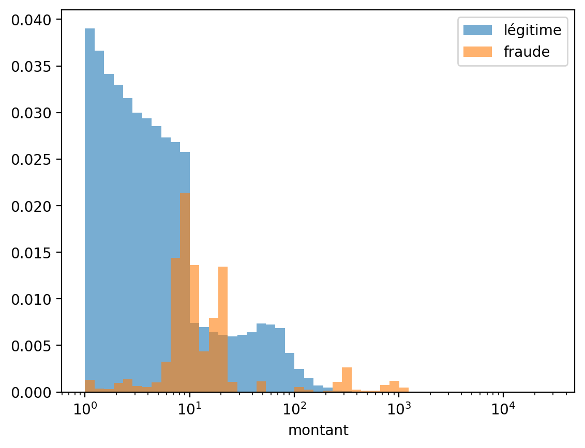

Les transactions légitimes se concentrent sur de petits montants. Les fraudes forment **trois groupes** : environ 8–25, ≈ 300 et 800–1 000+. Le montant seul ne suffit donc pas : les petites fraudes se confondent avec les transactions légitimes.

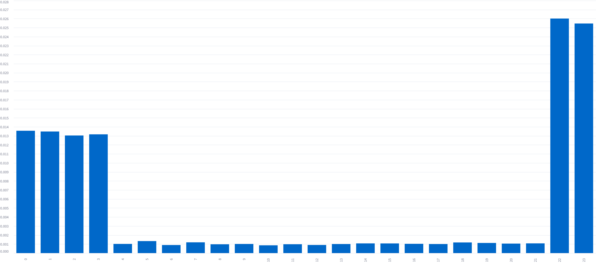

Le signal horaire est très net : **≈ 2,6 % à 22 h–23 h**, **≈ 1,3 % de 0 h à 3 h**, contre ≈ 0,1 % le reste de la journée. D'où les variables `is_night` et le codage cyclique de l'heure.

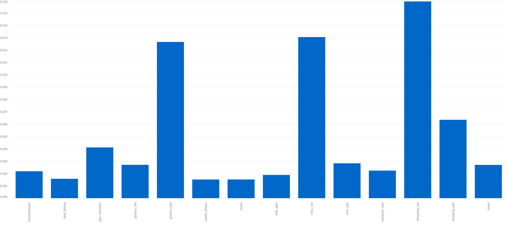

Catégories les plus risquées : `shopping_net` (≈ 1,6 %), `misc_net` (≈ 1,3 %) et `grocery_pos` (≈ 1,3 %).

## 5. Préparation (Module 2)

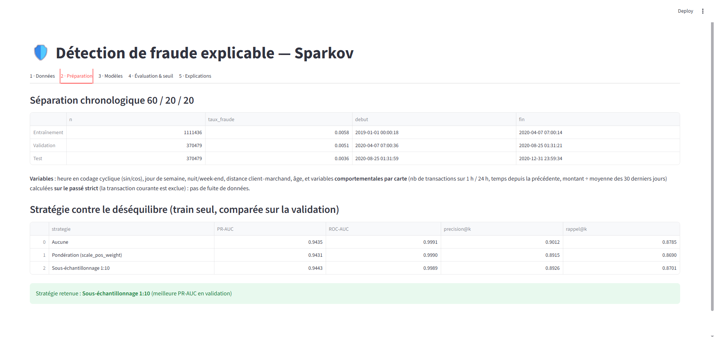

| Jeu | Transactions | Taux de fraude | Période |
|---|---|---|---|
| Entraînement | 1 111 436 | 0,576 % | 2019-01-01 → 2020-04-07 |
| Validation | 370 479 | 0,513 % | 2020-04-07 → 2020-08-25 |
| Test | 370 479 | 0,364 % | 2020-08-25 → 2020-12-31 |

**Comparaison des stratégies (XGBoost, validation, k = 0,5 %)**

| Stratégie | PR-AUC | ROC-AUC | précision@k | rappel@k |
|---|---|---|---|---|
| Aucune | 0,9435 | 0,9991 | 0,9012 | 0,8785 |
| Pondération | 0,9431 | 0,9990 | 0,8915 | 0,8690 |
| **Sous-échantillonnage 1:10** | **0,9443** | 0,9989 | 0,8926 | 0,8701 |

> **Lecture honnête** : les trois stratégies sont **à égalité** (écart de PR-AUC de 0,0012, dans le bruit d'une seule graine). Le sous-échantillonnage est retenu sur le critère fixé à l'avance (PR-AUC en validation), mais « Aucune » est légèrement meilleure sur précision@k et rappel@k. Aucune stratégie n'apporte de gain net sur ce jeu.

## 6. Modèles (Module 3)

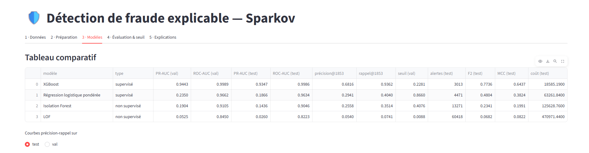

| Modèle | Type | PR-AUC test | ROC-AUC test | Précision@1853 | Rappel@1853 | F2 test | MCC test | Coût test |
|---|---|---|---|---|---|---|---|---|
| **XGBoost** | supervisé | **0,9347** | 0,9986 | **0,6816** | **0,9362** | **0,7736** | **0,6437** | **18 585** |
| Régression logistique pondérée | supervisé | 0,1866 | 0,9634 | 0,2941 | 0,4040 | 0,4804 | 0,3824 | 63 262 |
| Isolation Forest | non supervisé | 0,1436 | 0,9046 | 0,2558 | 0,3514 | 0,2341 | 0,1991 | 125 629 |
| LOF | non supervisé | 0,0260 | 0,8223 | 0,0540 | 0,0741 | 0,0682 | 0,0822 | 470 971 |

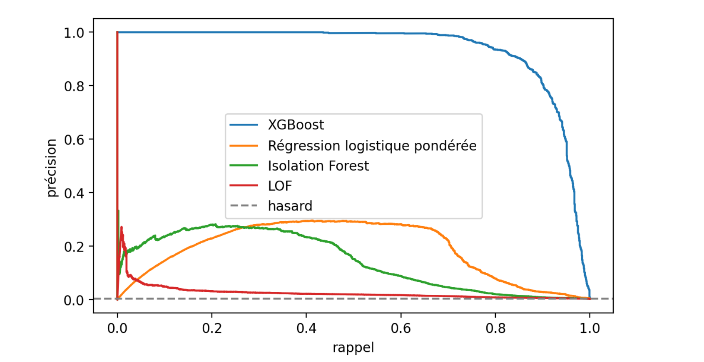

- **XGBoost domine nettement** : la précision reste proche de 1 jusqu'à ≈ 60 % de rappel.
- **Non supervisé nettement en retrait** : une fraude n'est pas forcément une anomalie statistique (les fraudeurs imitent des comportements plausibles), et Sparkov est simulé avec des règles que les arbres supervisés exploitent directement.
- **La régression logistique plafonne** (≈ 0,3 de précision) : elle est linéaire alors que la fraude dépend d'interactions (montant × heure × catégorie).
- **ROC-AUC trompeuse** : 0,96 pour la régression logistique alors que sa PR-AUC est de 0,19. C'est pour cela que les événements rares se jugent à la PR-AUC.

## 7. Évaluation et seuil (Module 4)

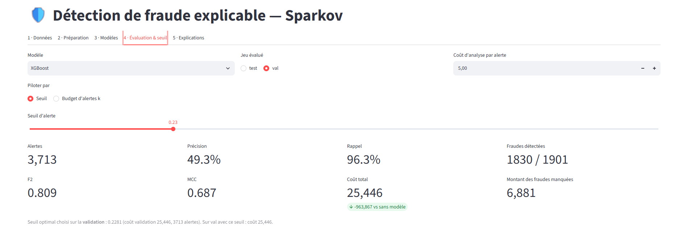

Sur la **validation** avec le seuil optimal (0,2281) :

| Alertes | Précision | Rappel | Fraudes détectées | F2 | MCC | Coût | Gain vs sans modèle |
|---|---|---|---|---|---|---|---|
| 3 713 | 49,3 % | 96,3 % | 1 830 / 1 901 | 0,809 | 0,687 | 25 446 | − 963 867 (≈ 97 %) |

Le coût se recalcule à la main : 6 881 (fraudes manquées) + 5 × 3 713 (alertes) = **25 446**. Sans modèle, le coût vaut 989 313 (≈ 520 par fraude en moyenne).

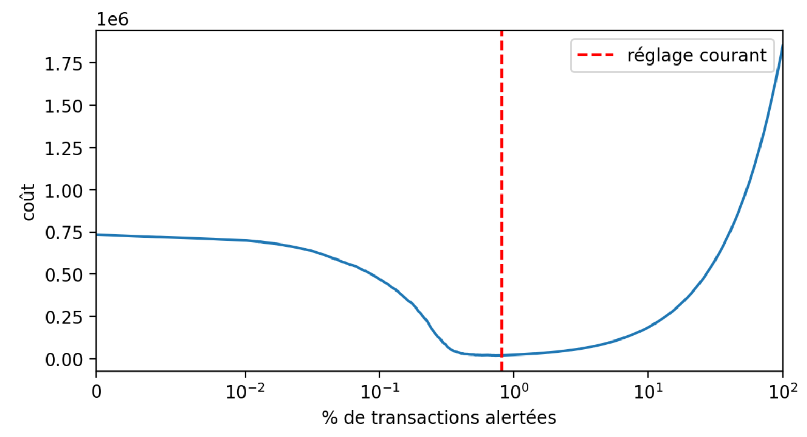

La courbe est **asymétrique** : le coût chute brutalement quand on passe de ≈ 0,1 % à ≈ 1 % d'alertes, puis remonte lentement ensuite. Rater des fraudes coûte beaucoup plus cher que sur-alerter, tant que le coût par alerte (5) reste très inférieur au montant moyen d'une fraude (≈ 520).

**Confirmation sur le test** (seuil fixé sur la validation) : 3 013 alertes, F2 = 0,774, MCC = 0,644, coût = 18 585.

> **Tension à expliquer** : le seuil de coût produit ≈ 3 000 alertes, soit plus que le budget k de 1 853. Si les analystes ne peuvent traiter que k alertes, le budget prime et on perd un peu de rappel. L'application permet de piloter **soit par seuil, soit par budget**, et de faire varier le coût par alerte pour visualiser ce compromis.

## 8. Explicabilité (Module 5)

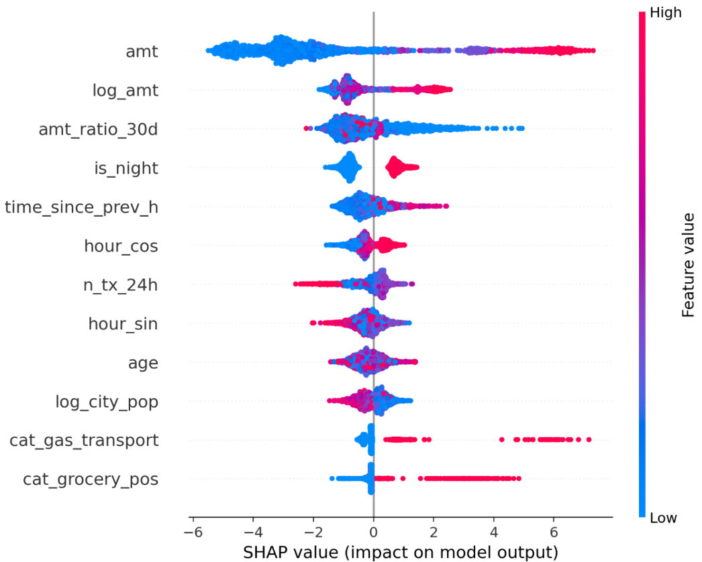

Variables les plus influentes : `amt`, `amt_ratio_30d`, `log_amt`, `is_night`, `time_since_prev_h`, `n_tx_24h`.

- **Cohérent avec l'exploration** : un montant élevé et une transaction nocturne poussent vers la fraude (voir section 4).
- **Points contre-intuitifs à signaler** : un `amt_ratio_30d` **faible** augmente le score de fraude, et un `n_tx_24h` **élevé** le diminue. Hypothèse (non démontrée) : dans Sparkov, les fraudes arrivent en salves nocturnes, de sorte que la moyenne des 30 derniers jours est déjà gonflée par une première fraude de montant élevé. La vitesse « beaucoup de transactions = fraude » n'est donc pas confirmée globalement par le simulateur.
- `cat_shopping_pos` apparaît avec un effet négatif alors que son taux brut est supérieur à la moyenne : SHAP mesure l'effet **toutes choses égales par ailleurs**, pas le taux brut de la section 4.

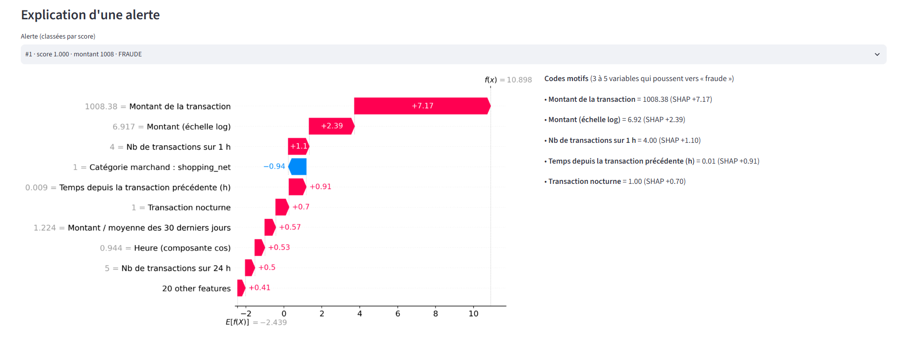

Alerte n° 1 (vraie fraude, montant 1 008, score 1,000) :
- Le **montant** domine (+ 7,2, + 2,4 pour sa version logarithmique).
- **4 transactions en 1 h** (+ 1,1) et **0,009 h (≈ 30 s) depuis la précédente** (+ 0,9) : signature de rafale.
- **Transaction nocturne** (+ 0,7).
- `shopping_net` contribue négativement (− 0,94) pour cette alerte, un exemple de l'interaction avec le montant.
- `E[f(X)] = −2,44` correspond à une probabilité de base de **8 %**, soit le taux de fraude du jeu d'entraînement **après sous-échantillonnage 1:10** (≈ 9 %). C'est cohérent : ce chiffre n'est pas le vrai taux de fraude (0,5 %), et les scores de ce modèle ne sont pas des probabilités calibrées.

**Codes motifs** : les variables redondantes sont fusionnées (`amt` + `log_amt`, `hour_sin` + `hour_cos`) pour éviter d'afficher deux fois le même motif.

## 9. API (Module 6)

```bash
uvicorn api:app --reload
```

`POST /predict` reçoit la transaction brute et l'historique récent de la carte (30 jours) ; les mêmes fonctions de variables que l'entraînement sont réutilisées, ce qui évite tout décalage entre entraînement et production.

```json
{
  "transaction": {
    "trans_date_trans_time": "2020-08-01 02:30:00", "cc_num": 1234567890123456,
    "amt": 950.0, "category": "shopping_net", "gender": "M",
    "lat": 40.0, "long": -90.0, "merch_lat": 48.0, "merch_long": -70.0,
    "city_pop": 50000, "dob": "1980-05-05"
  },
  "history": [{"trans_date_trans_time": "2020-07-30 12:00:00", "amt": 30.0}]
}
```

Réponse : `score`, `alerte` (booléen), `niveau_risque` et `codes_motifs` (3 à 5 variables avec leur contribution SHAP).

## 10. Limites

- **Données synthétiques** : les règles de fraude sont simulées ; les performances (PR-AUC ≈ 0,93) seraient plus basses sur des données réelles.
- **Une seule graine, pas d'intervalle de confiance** : les écarts entre stratégies de déséquilibre sont dans le bruit.
- **Décalage temporel** : le taux de fraude baisse entre entraînement et test ; aucune recalibration n'est faite.
- **Coût par alerte (5) fixé par hypothèse** : sa valeur change fortement le seuil optimal ; à discuter avec un analyste métier.
- **Probabilités non calibrées** à cause du sous-échantillonnage ; le seuil est choisi empiriquement sur le coût, pas sur la probabilité.
- **LOF** entraîné sur 20 000 lignes seulement, et sans variables catégorielles.
- **Équité** non étudiée (âge, genre) : à examiner avant tout usage réel.

